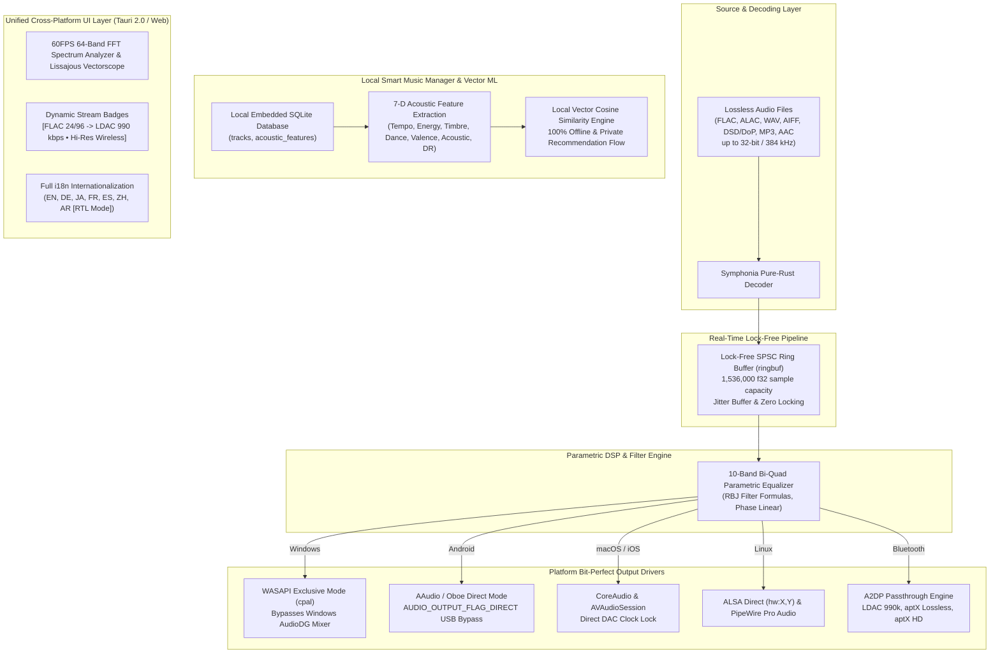

# Resonix Studio (Open Music Player)
> **High-Performance, Open-Source, 100% Free Cross-Platform High-Resolution Audio Player and Smart Music Manager**
> Built for Desktop (Windows, macOS, Linux) and Mobile (Android, iOS).

---

## 🎧 Architecture Overview

Resonix is an audiophile-grade audio player engineered to deliver bit-perfect playback directly to external DACs while bypassing OS sound mixers. It incorporates a lock-free SPSC ring buffer, pure-Rust audio decoding, high-definition Bluetooth codec passthrough, and an on-device machine-learning recommendation engine powered by 7-dimensional acoustic feature vectors and cosine similarity in embedded SQLite.



---

## 🚀 Key Features

### 1. Pure-Rust Audio Decoding (`symphonia`)
- Decodes **FLAC, ALAC, WAV, AIFF, DSD over PCM (DoP), MP3, and AAC**.
- Full support for master quality formats up to **32-bit / 384 kHz** and native **DSD64 / DSD128**.
- Zero-copy conversion of arbitrary bit depths (16-bit integer, 24-bit packed, 32-bit float) into normalized IEEE 754 32-bit floating point streams.

### 2. Microsecond Lock-Free Buffer Pipeline (`ringbuf`)
- SPSC (Single-Producer Single-Consumer) ring buffer bridging the background decoding thread and the real-time audio thread.
- Tracks buffer occupancy percentage, clock drift, and underflow occurrences in real-time.

### 3. Bit-Perfect Hardware Output Drivers
- **Windows**: `cpal` + WASAPI Exclusive mode (`AUDCLNT_SHAREMODE_EXCLUSIVE`) bypassing the Windows software mixer (`AudioDG.exe`).
- **Android**: `oboe-rs` / `AAudio` configuring `AUDIO_OUTPUT_FLAG_DIRECT` to bypass the 48kHz `AudioFlinger` resampler for external USB DACs (FiiO, Topping, Chord, iFi, etc.).
- **macOS / iOS**: CoreAudio & `AVAudioSession` locking DAC clock rates directly to prevent sample rate conversion.
- **Linux**: Direct ALSA hardware addressing (`hw:0,0`) and PipeWire bit-perfect Pro Audio routing.

### 4. Bluetooth Passthrough & Dynamic Badges
- Inspects active A2DP codecs:
  - **LDAC 990 kbps / 660 kbps / 330 kbps** (Hi-Res Audio Wireless Certified)
  - **Qualcomm aptX Lossless** (16-bit/44.1kHz bit-exact CD quality uncompressed)
  - **Qualcomm aptX HD** (24-bit/48kHz)
  - **Qualcomm aptX Adaptive** (40ms ultra-low latency)
  - **AAC & SBC**
- Feeds 24-bit/96kHz PCM streams directly without software downsampling.
- Displays dynamic badges: e.g. `[FLAC 24-bit/96kHz → LDAC 990 kbps • Hi-Res Wireless]`.

### 5. Local Smart Music Manager & Cosine Similarity ML
- Embedded SQLite schema (`tracks`, `acoustic_features`).
- 7-Dimensional normalized acoustic vector per track:
  1. **Tempo (BPM)**
  2. **Energy**
  3. **Spectral Centroid (Timbre Brightness)**
  4. **Danceability**
  5. **Valence (Musical Mood)**
  6. **Acousticness**
  7. **Dynamic Range (DR Rating / Crest Factor)**
- Local **Cosine Similarity**:
  $$\cos(\theta) = \frac{\mathbf{u} \cdot \mathbf{v}}{\|\mathbf{u}\| \|\mathbf{v}\|}$$
- Generates "Smart Flow" recommendations with human-readable rationale (e.g. *Harmonic & Timbre Resonance*, *Audiophile High-Dynamic Master Match*).
- Interactive SVG **Acoustic Profile Radar Chart** (7-axis spider chart).

### 6. Audiophile 10-Band Parametric Equalizer
- Implements Robert Bristow-Johnson (RBJ) audio biquad peaking/shelf filter math:
  - Centers: 31Hz, 63Hz, 125Hz, 250Hz, 500Hz, 1kHz, 2kHz, 4kHz, 8kHz, 16kHz
- Live SVG Spline Frequency Response Curve.
- Presets: *Studio Flat*, *Audiophile Warmth (Tube Sound)*, *Hi-Res Treble Air*, *Acoustic & Jazz*, *Vocal Intimacy*, *Sub-Bass Control*.

### 7. Full Internationalization (i18n) & Bidirectional RTL Layout
- Startup preferred language modal with persistence.
- Supported languages:
  - English (`en`)
  - German (`de`)
  - Japanese (`ja`)
  - Arabic (`ar` — **Complete RTL layout transformation!**)
  - French (`fr`)
  - Simplified Chinese (`zh`)
- Universal typography fallbacks (`Outfit`, `Plus Jakarta Sans`, `JetBrains Mono`).

---

## 📂 Directory Structure

```
Open Music Player/
├── src-tauri/                     # Tauri 2.0 Rust Core
│   ├── Cargo.toml                 # Symphonia, cpal, ringbuf, rusqlite, oboe
│   ├── tauri.conf.json            # Desktop & Mobile unified config
│   ├── capabilities/              # Tauri 2.0 permissions
│   │   └── default.json
│   └── src/
│       ├── main.rs                # Native entry point
│       ├── lib.rs                 # Tauri application builder & seed state
│       ├── commands.rs            # IPC command bridge
│       ├── audio/
│       │   ├── mod.rs
│       │   ├── decoder.rs         # Symphonia pure-Rust decoder
│       │   ├── engine.rs          # Lock-free SPSC ringbuf pipeline
│       │   ├── dsp.rs             # 10-band biquad parametric EQ
│       │   ├── bluetooth.rs       # LDAC/aptX detection & dynamic badges
│       │   └── output/
│       │       ├── mod.rs
│       │       ├── windows.rs     # WASAPI Exclusive mode
│       │       ├── android.rs     # AAudio DIRECT USB DAC bypass
│       │       ├── macos.rs       # CoreAudio bit-perfect
│       │       └── linux.rs       # ALSA Direct & PipeWire
│       ├── db/
│       │   ├── mod.rs
│       │   └── sqlite.rs          # SQLite tracks & acoustic vectors
│       └── ml/
│           ├── mod.rs
│           └── similarity.rs      # Local vector cosine similarity
├── src/                           # Audiophile Frontend Application
│   ├── index.css                  # Obsidian glassmorphism design system & RTL
│   ├── main.js                    # UI Coordinator
│   ├── audio-core.js              # High-Res WebAudio DSP & Tauri IPC fallback
│   ├── visualizer.js              # 60FPS 64-band FFT, Lissajous, Peak VU meters
│   ├── equalizer.js               # 10-band EQ manager & SVG spline curve
│   ├── smart-manager.js           # Local track manager & SVG radar chart
│   ├── bluetooth-manager.js       # Codec switcher & dynamic badge manager
│   └── i18n/
│       ├── i18n.js                # Dynamic locale switcher & RTL engine
│       └── locales.js             # Translation dictionaries
├── index.html                     # Semantic HTML5 template
├── package.json                   # Scripts & Vite setup
└── README.md                      # Documentation
```

---

## 🛠️ Build & Development Commands

### 1. Web & Local Live Preview
```bash
# Install dependencies
npm install

# Run Vite development server
npm run dev

# Build production client bundle
npm run build
```

### 2. Desktop Binaries (Windows, macOS, Linux)
```bash
# Run desktop development shell
npm run tauri dev

# Package native production desktop installer (MSI/EXE for Win, DMG for Mac, AppImage/DEB for Linux)
npm run tauri build
```

### 3. Mobile Binaries (Android, iOS)
```bash
# Initialize Android project
npm run tauri android init
# Run on Android connected device or emulator
npm run tauri android dev

# Initialize iOS project (on macOS with Xcode)
npm run tauri ios init
# Run on iOS Simulator or Device
npm run tauri ios dev
```

---

## 📜 License
100% Free and Open Source under the **MIT License**.
